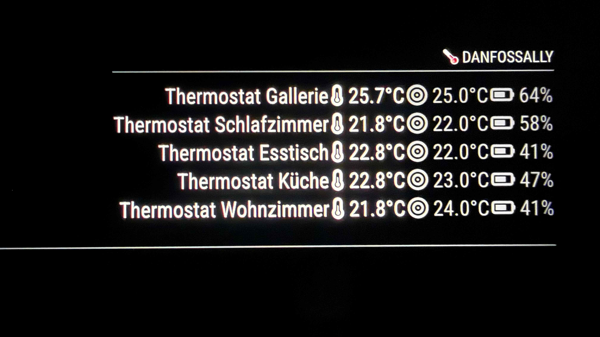

# MMM-DanfossAlly
A MagicMirror² module that displays your Danfoss Ally thermostat data.


## Prerequisites

Before you begin, you will need to obtain a Consumer Key and a Consumer Secret from Danfoss.

Step-by-Step Setup

1. Create an account: Go to the Danfoss Developer Portal and sign up using the same email address associated with your Danfoss Administrator account.
2. Access your apps: Once logged in, click on your name in the top right corner and select Apps.
3. Register a new app: Click Create an App. You can name it something descriptive, such as "My MagicMirror Danfoss App".
4. Copy your credentials: Once the app is created, copy the generated Consumer Key and Consumer Secret. You will need to paste these into your MagicMirror module configuration file.


## Installation

```bash
cd ~/MagicMirror/modules
git clone https://github.com/hannic/MMM-DanfossAlly
cd MMM-DanfossAlly
npm install
```


## Configuration
Add the module to the modules array in your `config/config.js` file:

    {
        module: "MMM-DanfossAlly",
        position: "top_right",
        config: {
            apiKey: "YOUR_DANFOSS_CONSUMER_KEY",
            apiSecret: "YOUR_DANFOSS_CONSUMER_SECRET",
            updateInterval: 300000 // 5 minutes
        }
    },




